# How a plot is made

This page explains how the viewer turns the plot controls into a figure: which
values are sent, how the backend chooses what you left empty, and how the page
shows what was chosen. The diagrams are generated from the code by
`scripts/architecture/generate.py` (see [architecture](architecture/README.md),
sections _Plot parameters_ and _Plot layout decision_).

## The principle: every control is optional

Each plot control (dimension slices, time range, row / col / col_wrap, x / y /
hue, colors, figure size, bins) can be left empty. **An empty control means
“choose it for me”; a control you set is kept as you set it.** The backend
fills the empty ones from the dimensions of the variable, after your choices.

So changing one control keeps the automatic choice of all the others:

| You set                                   | `root_data(time: 10, lat: 20, lon: 20)` is drawn as                                     |
| ----------------------------------------- | --------------------------------------------------------------------------------------- |
| nothing                                   | image, `col` time (wrap 4), `y` lat, `x` lon                                            |
| slice `lat` = `5:15`                      | the same, with 10 latitudes                                                             |
| `col_wrap` = 5                            | the same, 5 panels per row                                                              |
| slice `time` = `0`                        | one image, `y` lat, `x` lon                                                             |
| `x` = time                                | image, `x` time, `y` lon, `col` lat                                                     |
| `hue` = time, slice `lat` = `0:3`         | lines colored by time, `x` lon, `col` lat                                               |
| `row` = time                              | image, `row` time, `y` lat, `x` lon                                                     |
| `bins` = 20                               | histogram of every value (facets and axes are not used, a note says so)                 |
| `col` = depth (absent from this variable) | the automatic layout, and a note: `col=depth ignored: not a dimension of this variable` |

Before 0.13, setting any slice or layout control switched the whole plot to a
“user layout” where nothing was chosen automatically: slicing `lat` alone gave
a histogram of the 3D array instead of the time facets.

## In the webview: what is sent



1. **Create Plot** first checks the numbers typed (`invalidPlotOptions`): a
   wrong value blocks the plot with a message, instead of being silently ignored.
2. The Global Plot Controls and the variable's Group Plot Controls are read,
   then merged **field by field** (`mergePlotControls`): the group value when
   set, else the global one. Dimension slices are one block: the group's
   replace the global ones when the group has any. A group checkbox showing a
   dash uses the global value.
3. `compactPlotPayload` drops the empty fields: **only the fields you set are
   sent**, and become CLI flags (`buildCreatePlotCliArgs`).

### The “changed” outline

A field whose value differs from its default is outlined, with a dot after its
name (`changedFields.ts`). The outlines are therefore exactly what the request
overrides; everything else is automatic. The default of a field is:

| Field                  | Default (not outlined)                                      |
| ---------------------- | ----------------------------------------------------------- |
| text / number / select | empty, `None`                                               |
| checkbox (global)      | its initial state (`xincrease` on, `robust` off...)         |
| checkbox (group)       | the dash: use the global value                              |
| dimension slice        | the three boxes empty (the slider only mirrors them)        |
| time start / end       | the full range prefilled when a datetime variable is chosen |

**Reset** clears its block, and the outlines with it. Exported HTML keeps the
outlines of the moment of the export.

### The layout line under the plot

The result carries, next to the image, the layout the backend resolved
(`plot_layout`) and the slices it applied. A line under the plot lists them:

```
image   [lat 5:15]  col time  [col_wrap 5]  y lat  x lon  size 4  aspect 1     outlined: set by you · others: automatic
```

Items you set are outlined like the changed fields; the others were chosen
automatically, so that line tells which control to set to change them. Choices
that could not be used are listed below it, with the reason.

## In the backend: the layout decision



`create_plot` (`python/sdv_backend/plotting/api.py`) selects the data first:
`apply_dimension_slices` (`isel`), then `apply_datetime_filter`. **These only
select data; they never change how it is laid out.** Then
`resolve_layout` (`plotting/layout.py`) decides, in this order:

1. **Your choices** (`_user_pins`) of `x`, `y`, `hue`, `col`, `row`, in that
   order of precedence. `x` / `y` / `hue` take a dimension or a coordinate,
   `row` / `col` a dimension. A name absent from the variable (global controls
   apply to every variable) or already used by an earlier role is dropped with
   a note.
2. **`bins` set**: histogram of every value. Nothing else to lay out.
3. **Clean-up**: `hue` with both `x` and `y` drops `y` (a line plot has one
   axis); `hue` with no other dimension for the x-axis is dropped. Size-1
   dimensions you did not choose are taken at index 0 (`squeezed`: a slice
   `0:1` behaves like the index `0`).
4. **Plot kind**, from the dimensions left for the axes:
   - `hue` set: **lines** colored by hue;
   - two or more: **image**;
   - one: **line**;
   - none (a single value): **histogram**.
5. **Empty axes** take the last free dimensions, as xarray does: `x` the last,
   `y` the one before.
6. **Facets** for the dimensions still free: one goes to `col` (or `row` if
   you set `col`), two to `row` and `col`. More than the facets left can hold:
   histogram, with a note telling which dimensions to slice.
7. **`col_wrap`** (column facets without row facets only): yours, else
   `min(4, number of panels)`. **Figure size**: facet panels are 4 in high with
   aspect 1 unless you set them; a single plot keeps matplotlib's size unless
   you set one (an `aspect` alone gets the default height, xarray needs both).
8. A **1D line** whose x-axis was chosen automatically is drawn against the
   selected **datetime variable** when there is one of the same shape.

With nothing set, this is the automatic mode of earlier versions: 2D image,
3D column facets along the first dimension (4 per row), 4D row and column
facets, 1D line, more than 4 dimensions a histogram.

### The xarray call and the style options

`draw_plot` (`plotting/draw.py`) makes one call per kind and passes the style
options only where they are accepted (`PlotKwargsBundle.for_kind`):

| Kind      | xarray call                                                      | Style options passed                                         |
| --------- | ---------------------------------------------------------------- | ------------------------------------------------------------ |
| image     | `plot.imshow` (both axes are dimensions), else `plot.pcolormesh` | cmap, vmin, vmax, robust, add_colorbar, xincrease, yincrease |
| line      | `plot.line`                                                      | xincrease, yincrease, add_legend (with hue only)             |
| histogram | `plot.hist`                                                      | bins, xincrease, yincrease                                   |

A single map (both axes named like `lat` / `lon` / `x` / `y`, no facets, no
aspect set) gets equal x / y scales.

The JSON result keeps `applied_plot_kwargs` (the kwargs of the call) and adds
`plot_layout`:

```json
{
  "kind": "image",
  "choices": [
    { "role": "col", "value": "time", "source": "auto" },
    { "role": "col_wrap", "value": 5, "source": "user" },
    { "role": "y", "value": "lat", "source": "auto" },
    { "role": "x", "value": "lon", "source": "auto" },
    { "role": "size", "value": 4.0, "source": "auto" },
    { "role": "aspect", "value": 1.0, "source": "auto" }
  ],
  "squeezed": [],
  "notes": []
}
```

## Known limitations

- `imshow` assumes evenly spaced coordinates; irregular grids are drawn
  slightly off. Pick a non-dimension coordinate as `x` / `y` to get
  `pcolormesh`.
- A size-1 datetime dimension chosen as an image axis fails in xarray (both
  `imshow` and `pcolormesh`); the error is shown under the plot.
- More than four dimensions without slices give a histogram: slice one
  dimension to an index, or choose it as `row` / `col`.

## Code and tests

| What                  | Where                                                                    |
| --------------------- | ------------------------------------------------------------------------ |
| layout decision       | `python/sdv_backend/plotting/layout.py` (`resolve_layout`, `PlotLayout`) |
| xarray call           | `python/sdv_backend/plotting/draw.py`, `kwargs.py`                       |
| controls table, merge | `src/panel/webview/plotParams.ts`                                        |
| changed outline       | `src/panel/webview/changedFields.ts`, `styles.css`                       |
| layout line           | `src/panel/webview/render/plotLayout.ts`, `src/shared/plotLayout.ts`     |
| backend tests         | `python/tests/test_plot_layout.py`, `test_plot_drawing.py`               |
| webview tests         | `test/suite/ui/webviewScript.test.ts`                                    |
