<!-- Generated by scripts/architecture/generate.py from the source code: do not edit, run it again. -->

# Scientific Data Viewer architecture

How the VS Code extension is put together: three processes, two message boundaries, and the modules on each side. The module graphs are computed from the import statements in `src/` and `python/sdv_backend/`; the flows follow the code paths they name.

Generated from the source of v0.13.0. The same diagrams are in one page in [architecture.html](architecture.html): open it in a browser (it adds hover tooltips with module paths).

Colors: teal is the webview, blue the extension host, green the Python backend, yellow what lies outside the extension (VS Code, uv, data files, xarray), red a failure path. Solid arrows are calls, dashed arrows returns or responses.

## 1. Three processes, two boundaries

Each viewer tab is a sandboxed webview that can only post messages. The extension host owns the VS Code APIs and every panel's state. Python never stays resident: each info or plot request spawns `get_data_info.py`, which prints exactly one JSON line and exits.

_Teal arrows cross the webview boundary (postMessage); green arrows cross the process boundary (argv in, one JSON line out, logs on stderr forwarded to the Logger). The `common/` utilities used by every module (Logger, config, ErrorBoundary, runProcess), the status bar item and the healthcheck are left out._

Read: `src/extension.ts` · `src/DataViewerPanel.ts` · `src/panel/UIController.ts` · `src/python/PythonManager.ts` · `python/sdv_backend/cli.py`

## 2. The webview protocol

The webview sends requests and gets one response per request id; the host only emits events. Both maps are typed in `MessageTypes.ts` (the tables below are read from it) and mirrored by the webview's `bus.ts`. File names coming from the webview are resolved with `resolveWebviewFileName`, which rejects absolute paths and `..` segments.

| Request          | Payload                                                     | Result                                  | Host side                                       |
| ---------------- | ----------------------------------------------------------- | --------------------------------------- | ----------------------------------------------- |
| createPlot       | `PlotOptions`                                               | `string \| undefined`                   | `DataProcessor.createPlot`                      |
| abortPlot        | `{ operationId: string }`                                   | `{ success: boolean; message: string }` | `PythonManager.abortProcess`                    |
| savePlot         | `PlotFilePayload`                                           | `SaveResult`                            | writes next to the data file                    |
| savePlotAs       | `{ plotData: string; variable: string }`                    | `SaveResult`                            | save dialog                                     |
| openPlot         | `PlotFilePayload`                                           | `void`                                  | writes to the temp folder, opens it             |
| refresh          | `unknown`                                                   | `void`                                  | `loadFile` again                                |
| showNotification | `{ message: string; type: 'info' \| 'warning' \| 'error' }` | `void`                                  | info / warning / error toast                    |
| executeCommand   | `{ command: string; args?: unknown[] }`                     | `unknown`                               | only the commands in `WEBVIEW_ALLOWED_COMMANDS` |
| exportWebview    | `{ htmlContent: string }`                                   | `SaveResult`                            | saves the captured page                         |

| Event                      | Payload                                                     | Emitted when                         |
| -------------------------- | ----------------------------------------------------------- | ------------------------------------ |
| dataLoaded                 | `DataLoadedPayload`                                         | each successful load or refresh      |
| error                      | `{ message: string; details?: string; errorType?: string }` | `ErrorBoundary` handler of the panel |
| scrollToHeaderCommandEvent | `{ headerId: string; headerLabel: string }`                 | an outline entry is clicked          |
| exportWebviewCommandEvent  | `Record<string, never>`                                     | Export command from the palette      |

Read: `src/panel/communication/MessageTypes.ts` · `src/panel/communication/MessageBus.ts` · `src/panel/webview/bus.ts`

## 3. Extension host modules

Dependencies run top to bottom, from activation to leaf utilities. Edges out of `extension.ts` are faint because it wires everything. `Logger`, `config`, `vscodeutils` and `types` are imported almost everywhere and are left out.

_Thick borders mark the four classes on the main request path: DataViewerPanel, UIController, DataProcessor, PythonManager. Hover a box in the HTML page for its full path._

## 4. Webview bundle

Built separately by esbuild into `out/webview/webview.js`, with its own `tsconfig.json` and DOM types. Outside its own folder it imports only `src/shared/icons.ts` and `src/shared/ids.ts`, so the message protocol is the only runtime contract between the two sides. `plotParams.ts` is the single table of plot controls.

_`main.ts` installs one delegated click listener (the CSP forbids inline handlers) and dispatches on element ids and `data-action` attributes. Without a VS Code API (exported HTML opened in a browser) the bus runs in degraded mode and rejects every request._

## 5. Opening a file

The custom editor path, from double-clicking a `.nc` in the Explorer to a filled page and outline. Opening through a command goes through `DataViewerPanel.createOrReveal` instead of the provider, and joins this flow at `loadFile`.

_Step 2 is why panels never race the interpreter selection: the provider waits for `PythonManager`'s initialization promise before creating the panel. The outline caches headers per panel id and switches trees when another panel becomes visible._

## 6. Creating and cancelling a plot

The webview generates an `operationId` that travels down to `PythonManager`, which keeps one `AbortController` per running operation. Two timers read the same `plotTimeoutMs` setting (default 20 s): the webview's sends `abortPlot` when it fires, and the host's kills the process even when the panel is already gone.

_Each variable's Cancel button, like “Cancel all”, sends `abortPlot` and shows the plot as cancelled at once; the response that follows is ignored. “Create all plots” runs these requests with a concurrency limit so that cancel requests still get through. Steps 16 and 19 are the same `runProcess` stop routine: SIGTERM, then SIGKILL after a 1 s grace period._

Read: `src/panel/webview/plotActions.ts` · `src/python/PythonManager.ts (runPythonScript, abortProcess, parseScriptResult)` · `src/common/runProcess.ts`

## 7. Choosing the Python interpreter

Runs at activation and again when an interpreter-related setting changes, when workspace folders change, or when the Python extension reports a new active environment. Runs are single-flight: a request made during a run queues one more run, and only the latest run commits its result.

_When the extension's own environment is enabled but unusable, the reason is kept in `ownEnvironmentIssue` and shown to the user (for example “uv is not installed”) instead of switching interpreters silently._

Read: `src/python/PythonManager.ts (forceInitialize, selectInterpreter, prepareOwnEnvironment)` · `src/python/officialPythonExtensionApiUtils.ts`

## 8. The extension-owned uv environment

Applies only with `useExtensionOwnEnvironment` on; override and Python-extension interpreters are never modified. Bumping `ENVIRONMENT_REVISION`, or changing `ALL_REQUIREMENTS` or `ENVIRONMENT_CONSTRAINTS`, makes every existing environment rebuild once at the next start. All operations on the folder go through one promise queue, so startup, a settings change and the Manage command never install at the same time.

_The environment lives in the extension's globalStorage as `python-environment/`, with `sdv-environment.json` recording the revision and requirements it was built with. A rebuild interrupted by closing VS Code is repaired by the first check at the next start._

Read: `src/python/ExtensionVirtualEnvironmentManager.ts` · `src/python/ExtensionVirtualEnvironmentManagerUI.ts` · `scripts/upgrade-sandbox.sh`

## 9. Python backend packages

At package level, with each edge labelled by the modules it imports. Dependencies only flow downward, from `cli` through `info` / `plotting` and `opening` to `formats` and `environment`. The one sideways edge is `plotting → info`, which reuses the DataTree inheritance mode and the monotonicity check.

_`cli → formats` is `resolve_store_path`: opening a Zarr metadata file opens the store that contains it. `python/get_data_info.py` only puts the package on `sys.path` and calls `cli.main`._

## 10. Backend pipelines

Both subcommands share format detection and opening, then diverge. Info walks every group to describe it; plot selects one variable, subsets it and draws it with xarray's plotting on the Agg backend.

_The extension builds both command lines in `DataProcessor` (`buildGetDataInfoCliArgs`, `buildCreatePlotCliArgs`) from the user's settings; nothing is passed through a shell._

Read: `python/sdv_backend/info/extract.py` · `python/sdv_backend/plotting/api.py` · `python/sdv_backend/opening.py` · `python/sdv_backend/formats/detect.py`
